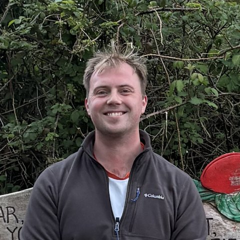
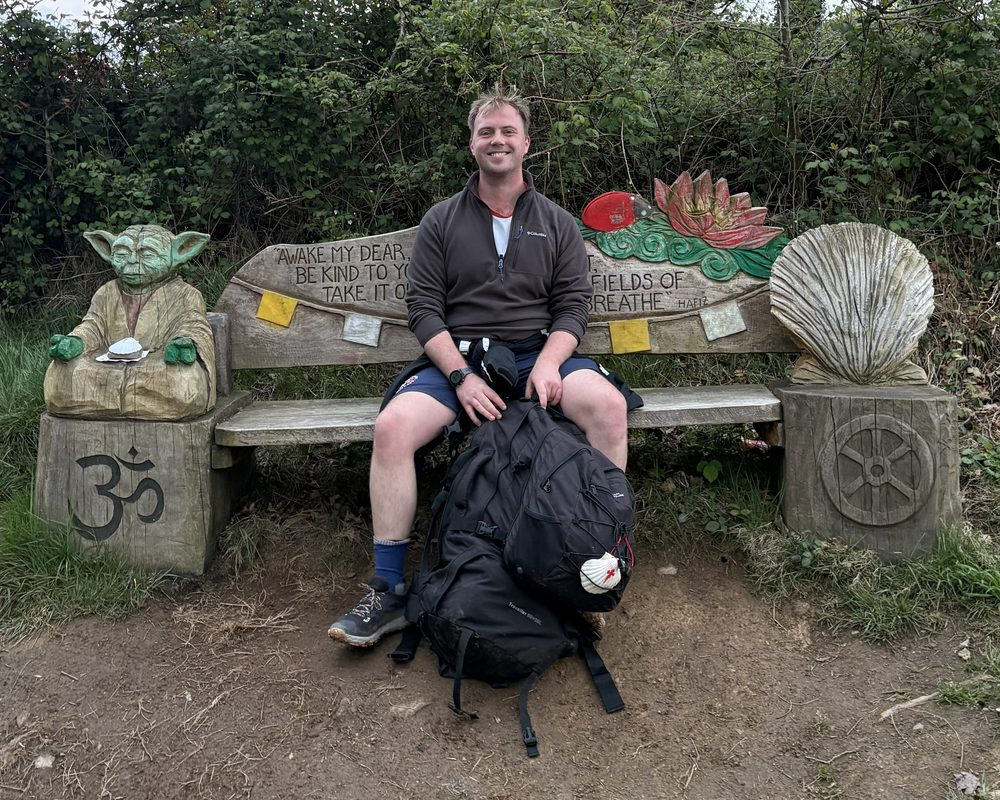

::::: {.home}

:::: {.hero}
::: {.hero-text}
{.avatar fig-alt="Rhys Inward"}

[Field epidemiology · Genomic surveillance · Arboviruses]{.eyebrow}

# Rhys Inward

::: {.lead}
I'm a field epidemiology fellow with the UK Health Security Agency (UKHSA) and a final-year DPhil candidate at the University of Oxford. I use pathogen genomes, surveillance data, and climate and mobility data to understand how infections such as dengue, chikungunya and SARS-CoV-2 are introduced and spread, and to turn that into evidence for surveillance and outbreak response.
:::

::: {.hero-links}
[Research](research.qmd){.btn-ink} [Tutorials](tutorials/index.qmd){.btn-line} [CV](cv.qmd){.btn-line}
:::
:::

::: {.hero-figure}
```{=html}
<figure class="hero-video">
  <div class="hero-video-frame">
    <video controls muted loop playsinline preload="metadata" poster="assets/video/denv2-ii-poster.jpg" width="1080" height="1080"
      aria-label="Animated map of South and Southeast Asia and southern China with a phylogenetic tree beneath it. From 1998 to 2023, lines show dengue virus 2 lineages moving between countries, circles grow and shrink with the number of lineages in each place, and the tree fills in with colour as time passes.">
      <source src="assets/video/denv2-ii.mp4" type="video/mp4">
    </video>
    <button type="button" class="hero-video-toggle" hidden aria-label="Pause the animation">
      <svg class="icon-pause" viewBox="0 0 16 16" aria-hidden="true"><rect x="3.5" y="2.5" width="3" height="11" rx="1"/><rect x="9.5" y="2.5" width="3" height="11" rx="1"/></svg>
      <svg class="icon-play" viewBox="0 0 16 16" aria-hidden="true"><path d="M4.5 2.8v10.4a.6.6 0 0 0 .9.5l8.2-5.2a.6.6 0 0 0 0-1L5.4 2.3a.6.6 0 0 0-.9.5z"/></svg>
    </button>
  </div>
  <ul class="hero-key" aria-label="Colour key for the animation">
    <li style="--k: #8F5F12">South Asia</li>
    <li style="--k: #2C7652">Mainland Southeast Asia</li>
    <li style="--k: #B2433A">Vietnam</li>
    <li style="--k: #2B5C8A">Maritime Southeast Asia</li>
    <li style="--k: #7A4D80">China and Taiwan</li>
  </ul>
  <figcaption class="hero-caption">Dengue virus 2, genotype II (Cosmopolitan), moving between South and Southeast Asia and southern China, 1998–2023, reconstructed from 1,627 genomes. Lines are inferred movements, fainter where less certain; circles show the lineages in each place. From my DPhil work, in preparation. Made with <a href="https://github.com/evogytis/baltic">baltic</a>, after Gytis Dudas.</figcaption>
</figure>
```
:::
::::

:::: {.home-section}
::: {.section-head}
## From research to public health

[Field epidemiology →](research.qmd#field-epidemiology)
:::

::: {.themes .ph-themes}
::: {.theme .k-public-health}
[Surveillance]{.tag}

### Seeing outbreaks clearly

How sampling and reporting shape what genomic and case data can tell us ([*Nature Communications*](https://doi.org/10.1038/s41467-022-32812-0), [*Epidemics*](https://doi.org/10.1016/j.epidem.2022.100627)), and how surveillance and modelling can work globally ([*Nature Medicine*](https://doi.org/10.1038/s41591-026-04351-4)).
:::

::: {.theme .k-dengue}
[Spread]{.tag}

### Tracing introductions

Reconstructing how pathogens arrive and spread: Omicron and Delta in England ([*Science*](https://doi.org/10.1126/science.adg6605), [*Nature*](https://doi.org/10.1038/s41586-022-05200-3)), dengue in Vietnam ([*EID*](https://doi.org/10.3201/eid2910.230529)) and cholera in Malawi ([*EID*](https://doi.org/10.3201/eid3106.240930)).
:::

::: {.theme .k-field}
[UKFETP]{.tag}

### On the front line

Since September 2026, applying these skills with UKHSA's North West Field Service: surveillance, outbreak response and applied projects.
:::

::: {.theme .k-methods}
[Tools]{.tag}

### Analyses others can rerun

Reproducible pipelines that researchers and public health teams can run locally, including [GRAPEVNE](https://doi.org/10.12688/wellcomeopenres.23824.1) and a [data pipeline for climate-sensitive diseases](https://doi.org/10.12688/wellcomeopenres.24774.3).
:::
:::
::::

:::: {.home-section}
::: {.section-head}
## Selected publications

[All publications →](publications.qmd)
:::

::: {#featured-pubs}
:::
::::

:::: {.home-section}
::: {.section-head}
## What I work on

[Research →](research.qmd)
:::

::: {.themes}
::: {.theme .k-dengue}
[DENV]{.tag}

### Dengue genotype dynamics

Where new dengue genotypes come from, how they spread, and why some replace the ones already circulating.
:::

::: {.theme .k-chik}
[CHIKV]{.tag}

### Chikungunya transmission

Renewal-equation models of chikungunya outbreaks in France and Brazil, and how climate shapes them.
:::

::: {.theme .k-field}
[UKFETP]{.tag}

### Field epidemiology

Surveillance, outbreak response and applied projects with UKHSA's North West Field Service.
:::

::: {.theme .k-ppie}
[PPIE]{.tag}

### Patient & public involvement

Working with patients, families and the public on research questions and tools.
:::
:::
::::

:::: {.home-section}
::: {.section-head}
## Latest tutorials

[All tutorials →](tutorials/index.qmd)
:::

::: {#latest}
:::
::::

:::: {#contact .home-section}
::: {.contact}
::: {.contact-text}
## Get in touch

I'm happy to talk about collaborations, field epidemiology and patient involvement, or, away from work, hiking, squash and choral music. Email [](mailto:).

::: {.contact-links}
[Google Scholar](https://scholar.google.com/citations?user=MG7ctSYAAAAJ) [ORCID](https://orcid.org/0000-0003-0016-661X) [GitHub](https://github.com/rhysinward) [LinkedIn](https://www.linkedin.com/in/rhys-inward-4750a71b2/)
:::
:::

::: {.contact-photo}
{fig-alt="Rhys smiling on a carved wooden bench, between a wooden Yoda and a carved scallop shell"}
:::
:::
::::

:::::
