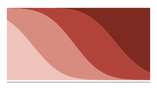
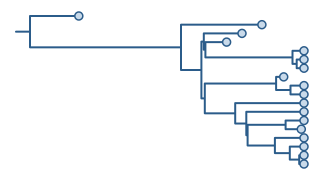
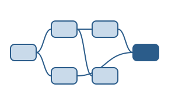

::::: {.research-theme .k-dengue}
:::: {.grid}
::: {.g-col-12 .g-col-md-7}
[DENV]{.tag}

## Dengue genotype dynamics

Each of dengue's four serotypes is made up of genotypes that rise and fall. I use phylogenetics and phylodynamics to work out where new genotypes come from, how they spread, and why some replace those already circulating.

- How introduction, establishment and amplification shape the replacement of DENV-2 genotypes in Vietnam
- The global expansion of the DENV-2 Cosmopolitan genotype after the COVID-19 pandemic, with selection analyses across the genome
- How dengue lineages spread and become established across Southeast Asia, combining phylogeography with environmental suitability modelling

::: {.related}
[Dengue primer](tutorials/dengue-primer.qmd) · [Genotype replacement tutorial](tutorials/genotype-replacement.qmd) · [Cosmopolitan DENV-2 in southern Vietnam (*Emerging Infectious Diseases*, 2023)](https://doi.org/10.3201/eid2910.230529)
:::
:::

::: {.g-col-12 .g-col-md-5}
{.theme-fig fig-alt="Four coloured bands, each taking over from the one before it over time"}
:::
::::
:::::

::::: {.research-theme .k-chik}
:::: {.grid}
::: {.g-col-12 .g-col-md-7}
[CHIKV]{.tag}

## Chikungunya transmission and climate

I model chikungunya outbreaks in France and Brazil with renewal equations and generalised additive models, to separate the roles of climate, importation and immunity in each setting, and use climate counterfactuals to ask how much climate shaped transmission.

::: {.related}
[Chikungunya primer](tutorials/chikungunya-primer.qmd) · [Renewal-equation tutorial](tutorials/renewal-rt.qmd)
:::
:::

::: {.g-col-12 .g-col-md-5}
{.theme-fig fig-alt="A reproduction number curve falling below one, with an uncertainty band"}
:::
::::
:::::

::::: {.research-theme .k-sars}
:::: {.grid}
::: {.g-col-12 .g-col-md-7}
[SARS-CoV-2]{.tag}

## Genomic epidemiology of COVID-19

Before my DPhil I studied how SARS-CoV-2 variants were introduced and spread, and how the way genomes and cases are sampled shapes what we can learn from them.

- How Omicron BA.1 invaded England (*Science*, 2023, joint first author) and how the Delta variant emerged and grew (*Nature*, 2022)
- Which genomes to sequence: sampling strategies for estimating epidemiological parameters (*Nature Communications*, 2022)
- Biases in COVID-19 surveillance data, with the Global.health consortium (*Epidemics*, 2022)
- Lineage dynamics in Mexico (*eLife*, 2023) and Chile (*PNAS Nexus*, 2024)

::: {.related}
[Publications](publications.qmd) · [Sampling strategies code](https://github.com/rhysinward/Phylodynamic-Subsampling)
:::
:::

::: {.g-col-12 .g-col-md-5}
{.theme-fig fig-alt="A small phylogenetic tree"}
:::
::::
:::::

::::: {.research-theme .k-methods}
:::: {.grid}
::: {.g-col-12 .g-col-md-7}
[Methods]{.tag}

## Reproducible pipelines

[GRAPEVNE](https://grapevne.readthedocs.io) is a graphical environment for building and sharing analysis pipelines in infectious disease research, and a chapter of my thesis. I write my own genomic workflows (alignment, tree building, dating and selection analyses) as Snakemake pipelines so others can rerun them.

::: {.related}
[GRAPEVNE paper (*Wellcome Open Research*, 2025)](https://doi.org/10.12688/wellcomeopenres.23824.1) · [Dengue pipeline](https://github.com/rhysinward/dengue_pipeline) · [Code on GitHub](https://github.com/rhysinward)
:::
:::

::: {.g-col-12 .g-col-md-5}
{.theme-fig fig-alt="Boxes joined by arrows, like the steps of an analysis pipeline"}
:::
::::
:::::

::::: {.research-theme .k-field}
:::: {.grid}
::: {.g-col-12 .g-col-md-7}
[UKFETP]{.tag}

## Field epidemiology

Since September 2026 I've been a fellow on the UK Field Epidemiology Training Programme, based at UKHSA's North West Field Service in Liverpool. The work spans surveillance, outbreak response and applied projects across infectious diseases.
:::

::: {.g-col-12 .g-col-md-5}
{.theme-fig fig-alt="An epidemic curve drawn with one square per case"}
:::
::::
:::::

## Collaborators

I work with colleagues at the Oxford University Clinical Research Unit (OUCRU) in Vietnam. I've also worked with the Global.health consortium and COVID-19 Genomics UK (COG-UK), and gave invited lectures at genomic epidemiology workshops at OUCRU in Ho Chi Minh City and the Universidad Autónoma de Yucatán in Mérida.
