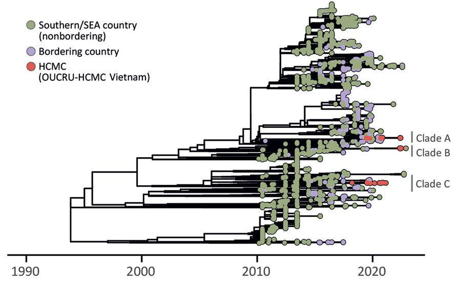
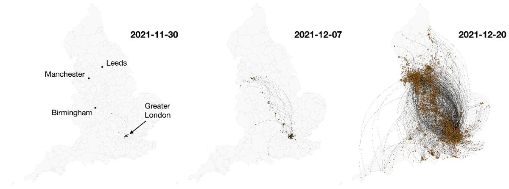
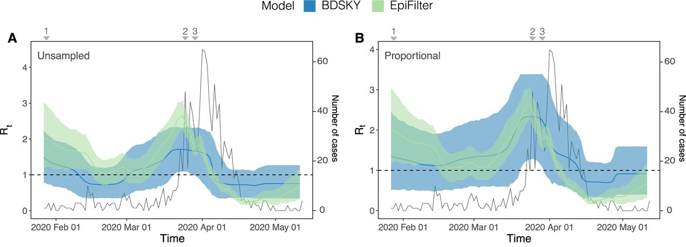
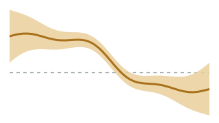
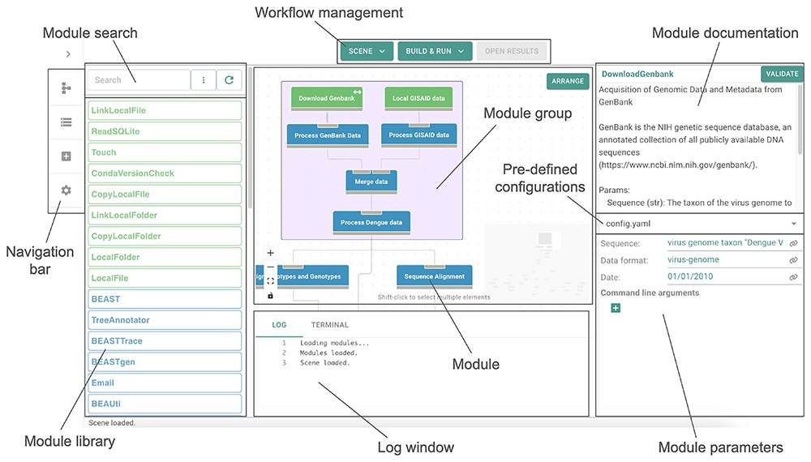
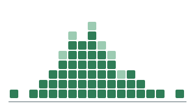

::: {.research-intro}
I turn pathogen genomes and surveillance data into evidence for public health: where infections come from, how they spread once they arrive, and how genomic surveillance should be designed to answer those questions. Below are the main findings from my published work, with figures and links to each paper. Work still in preparation is marked as such.
:::

::::: {.research-theme .k-dengue}
:::: {.grid}
::: {.g-col-12 .g-col-md-7}
[DENV]{.tag}

## Dengue genotype dynamics

Each of dengue's four serotypes is made up of genotypes that rise and fall. I use phylogenetics and phylodynamics to work out where new genotypes come from, how they spread, and why some replace those already circulating.

::: {.findings}
[What we found]{.findings-label}

- Among dengue patients sampled at the Hospital for Tropical Diseases in Ho Chi Minh City, DENV-2 replaced DENV-1 as the predominant serotype in 2019, with several DENV-2 genotypes circulating side by side.
- The Cosmopolitan genotype re-emerged through at least three separate recent introductions into southern Vietnam (clades A, B and C), sharing ancestry with sequences from Indonesia (A and B) and Cambodia (C).
- Two of these clades had persisted locally for at least five years, roughly two years before they were first sampled, suggesting undetected transmission across several dengue seasons.

[Tran, Inward et al., *Emerging Infectious Diseases* 2023 (joint first author)](https://doi.org/10.3201/eid2910.230529)
:::

::: {.findings .in-progress}
[Now working on]{.findings-label}

- How introduction, establishment and amplification shape the replacement of DENV-2 genotypes in Vietnam
- The global expansion of the DENV-2 Cosmopolitan genotype after the COVID-19 pandemic, with selection analyses across the genome
- How dengue lineages spread and become established across Southeast Asia, combining phylogeography with environmental suitability modelling
:::

::: {.related}
[Dengue primer](tutorials/dengue-primer.qmd) · [Genotype replacement tutorial](tutorials/genotype-replacement.qmd)
:::
:::

::: {.g-col-12 .g-col-md-5}
::: {.real-fig}
{fig-alt="Time-scaled phylogenetic tree of the DENV-2 Cosmopolitan genotype from 1990 to the early 2020s, with Ho Chi Minh City sequences in red falling into three clades labelled A, B and C"}

[Time-scaled phylogeny of the DENV-2 Cosmopolitan genotype. Sequences from Ho Chi Minh City (red) fall into three clades, A to C. From [Tran, Inward et al., *Emerging Infectious Diseases* 2023](https://doi.org/10.3201/eid2910.230529) (public domain).]{.fig-credit}
:::
:::
::::
:::::

::::: {.research-theme .k-sars}
[SARS-CoV-2]{.tag}

## How variants were introduced and spread

Before my DPhil I worked on how SARS-CoV-2 variants of concern arrived in England and what drove their spread once they were there.

:::: {.grid}
::: {.g-col-12 .g-col-md-6}
::: {.findings}
[Omicron BA.1]{.findings-label}

- Analysing 115,622 genomes, we identified more than 6,000 separate introductions of Omicron BA.1 into England.
- Six of the eight largest lineages were already spreading when Omicron was first reported on 22 November 2021, and importation continued despite travel restrictions because well-connected countries elsewhere were exporting it.
- About 6% of introductions accounted for about 80% of BA.1 infections reported in England up to the end of January 2022.

[Tsui, McCrone, Lambert, Bajaj, Inward, Bosetti et al., *Science* 2023 (joint first author)](https://doi.org/10.1126/science.adg6605)
:::
:::

::: {.g-col-12 .g-col-md-6}
::: {.findings}
[Delta]{.findings-label}

- Delta was introduced into England an estimated minimum of 1,458 times, and about half of these introductions (56.5%) came from India.
- After hotel quarantine began, the share of introductions from India that led to onward transmission in England fell from 37.7% to 26.9%.
- Once Delta was established, faster spread was associated with local population mixing rather than with the number of new importations.

[McCrone, Hill, Bajaj et al., *Nature* 2022](https://doi.org/10.1038/s41586-022-05200-3)
:::
:::
::::

::: {.real-fig .wide}
{fig-alt="Three maps of England on 30 November, 7 December and 20 December 2021, showing an Omicron transmission lineage starting in Greater London and spreading across the country"}

[The largest Omicron BA.1 transmission lineage spreading out of Greater London, 30 November to 20 December 2021, reconstructed by continuous phylogeography. Adapted (cropped) from [Tsui, McCrone, Lambert, Bajaj, Inward, Bosetti et al., *Science* 2023](https://doi.org/10.1126/science.adg6605) (author manuscript, [CC BY 4.0](https://creativecommons.org/licenses/by/4.0/)).]{.fig-credit}
:::

::: {.related}
Also: lineage dynamics in Mexico ([*eLife* 2023](https://doi.org/10.7554/eLife.82069), joint first author) and Chile ([*PNAS Nexus* 2024](https://doi.org/10.1093/pnasnexus/pgae483)).
:::
:::::

::::: {.research-theme .k-public-health}
[Surveillance]{.tag}

## Designing genomic surveillance

Which genomes get sequenced, and how cases are reported, shapes what surveillance data can tell us. Getting this right matters most where surveillance resources are limited.

:::: {.grid}
::: {.g-col-12 .g-col-md-6}
::: {.findings}
[Sampling genomes]{.findings-label}

- How sequences are chosen changes estimates of Rt and the growth rate, while R0 and the estimated date an outbreak began stay relatively stable.
- In Hong Kong, sampling sequences in proportion to weekly case numbers matched case-based Rt most closely. In Amazonas, Brazil, opportunistic sampling gave the estimates that differed most.
- Molecular clock dating placed the emergence of the Gamma variant in Amazonas in late October to early November 2020, about five weeks before the first reported case.

[Inward, Parag & Faria, *Nature Communications* 2022 (first author)](https://doi.org/10.1038/s41467-022-32812-0) · [Code](https://github.com/rhysinward/Phylodynamic-Subsampling)
:::
:::

::: {.g-col-12 .g-col-md-6}
::: {.findings}
[Reporting delays]{.findings-label}

- Reporting delays varied markedly between states and over time in Argentina, Brazil, Colombia and Mexico.
- Changing the geographical scale of the analysis shifted estimates of how fast cases were growing by up to 0.13 per day.
- Applying national-level corrections to a single state could mislead: in Roraima, Brazil, the epidemic appeared to have stabilised while cases were still changing substantially.

[Inward, Jackson et al., *Epidemics* 2022 (joint first author)](https://doi.org/10.1016/j.epidem.2022.100627)
:::
:::
::::

::: {.real-fig .wide}
{fig-alt="Two panels of time-varying reproduction number in Hong Kong in early 2020, comparing estimates from genomes and from case data for unsampled and proportionally sampled sequences"}

[Hong Kong, early 2020: Rt estimated from genomes (BDSKY, blue) and from cases (EpiFilter, green), using all available sequences (left) and sequences sampled in proportion to cases (right). Adapted (cropped) from [Inward, Parag & Faria, *Nature Communications* 2022](https://doi.org/10.1038/s41467-022-32812-0) ([CC BY 4.0](https://creativecommons.org/licenses/by/4.0/)).]{.fig-credit}
:::
:::::

::::: {.research-theme .k-chik}
:::: {.grid}
::: {.g-col-12 .g-col-md-7}
[CHIKV]{.tag}

## Chikungunya transmission and climate

I model chikungunya outbreaks in France and Brazil with renewal equations and generalised additive models, to separate the roles of climate, importation and immunity in each setting, and use climate counterfactuals to ask how much climate shaped transmission.

::: {.findings .in-progress}
[In preparation]{.findings-label}

Manuscript in preparation. I presented this work as a poster at the International Pandemic Sciences Conference in Singapore in 2026.
:::

::: {.related}
[Chikungunya primer](tutorials/chikungunya-primer.qmd) · [Renewal-equation tutorial](tutorials/renewal-rt.qmd)
:::
:::

::: {.g-col-12 .g-col-md-5}
{.theme-fig fig-alt="Illustration of a reproduction number curve falling below one, with an uncertainty band"}
:::
::::
:::::

::::: {.research-theme .k-methods}
:::: {.grid}
::: {.g-col-12 .g-col-md-7}
[Methods]{.tag}

## Reproducible pipelines

[GRAPEVNE](https://grapevne.readthedocs.io) is a graphical environment for building and sharing analysis pipelines in infectious disease research, and a chapter of my thesis. I write my own genomic workflows (alignment, tree building, dating and selection analyses) as Snakemake pipelines so others can rerun them.

::: {.findings}
[What we built]{.findings-label}

- GRAPEVNE: an open-source platform for building modular analysis pipelines through a graphical interface, shaped by consulting about 50 infectious disease modellers, bioinformaticians and genomic epidemiologists.
- Our dengue pipeline automates the whole process from retrieving sequences to phylogeographic inference, and can be shared without revealing the underlying data.
- DART: an open pipeline that brings climate, socio-economic and population data together for disease modelling. It can run locally, so surveillance data need not leave the country, and was demonstrated on dengue in Vietnam.

[Brittain, Tsui, Inward et al., *Wellcome Open Research* 2025 (joint first author)](https://doi.org/10.12688/wellcomeopenres.23824.1) · [Dasgupta et al., *Wellcome Open Research* 2025](https://doi.org/10.12688/wellcomeopenres.24774.3)
:::

::: {.related}
[Dengue pipeline](https://github.com/rhysinward/dengue_pipeline) · [Code on GitHub](https://github.com/rhysinward)
:::
:::

::: {.g-col-12 .g-col-md-5}
::: {.real-fig}
{fig-alt="Screenshot of the GRAPEVNE interface showing a module library, a canvas with a dengue workflow built from linked modules, and a module documentation panel"}

[The GRAPEVNE interface, with a dengue workflow built from linked modules. From [Brittain, Tsui, Inward et al., *Wellcome Open Research* 2025](https://doi.org/10.12688/wellcomeopenres.23824.1) ([CC BY 4.0](https://creativecommons.org/licenses/by/4.0/)).]{.fig-credit}
:::
:::
::::
:::::

::::: {.research-theme .k-field}
:::: {.grid}
::: {.g-col-12 .g-col-md-7}
[UKFETP]{.tag}

## Field epidemiology

Since September 2026 I've been a fellow on the UK Field Epidemiology Training Programme, based at UKHSA's North West Field Service in Liverpool. It is a two-year, full-time fellowship run by UKHSA and accredited by TEPHINET.

Fellows learn on the job across outbreak investigation, surveillance, applied research, scientific communication and teaching. The programme also supports UKHSA's international outbreak response and capacity building, which is where I want to connect genomic epidemiology with public health practice.
:::

::: {.g-col-12 .g-col-md-5}
{.theme-fig fig-alt="Illustration of an epidemic curve drawn with one square per case"}
:::
::::
:::::

## Collaborators

I work with colleagues at the Oxford University Clinical Research Unit (OUCRU) in Vietnam. I've also worked with the Global.health consortium and COVID-19 Genomics UK (COG-UK), and gave invited lectures at genomic epidemiology workshops at OUCRU in Ho Chi Minh City and the Universidad Autónoma de Yucatán in Mérida.
